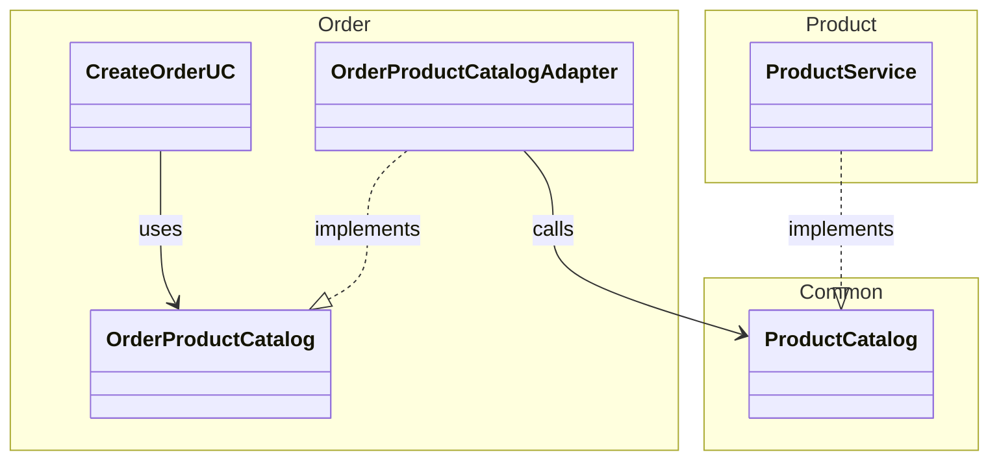

# ADR-0006: Use in-process ports between modules

- **Status:** Accepted
- **Date:** 2026-11-28

## Context

Some use cases need an immediate result from another module. Order creation needs product details before it can build order items. Both modules run in the same NestJS process in this interview project.

## Decision

Use in-process calls for cross-module operations that need an immediate result. Define the public contract in `src/common/ports` and have the providing module implement and export it. The calling module defines an application port for what its use case needs. Its infrastructure adapter calls the shared port and maps the result when needed. NestJS module files wire the ports to their implementations.

For order creation, wire `CreateOrderUC` to `OrderProductCatalogAdapter` through `OrderProductCatalog`. The adapter calls the shared `ProductCatalog` port, which `ProductModule` exports with `ProductService` as its implementation. Payment and shipment lookups and physical stock reservation already use this pattern.

## Alternatives considered

- **gRPC** would add service definitions and client/server setup for modules that already share a process.
- **RabbitMQ request/reply** would reuse the broker but add serialization, reply correlation, timeouts, and broker availability to each call. RabbitMQ carries asynchronous workflow commands and events.

## Consequences

Use cases depend on their own application ports. Cross-module calls sit behind infrastructure adapters, and each provider retains ownership of its data and operations. Tests can substitute the local port. Each integration adds a shared contract, a local port, and adapter wiring. Moving a provider to a separate process would require a transport adapter and explicit handling of remote failures and any shared transaction boundaries.

## Related files

- [ADR-0004: Use hexagonal architecture for order processing](0004-use-selective-hexagonal-architecture.md)
- [Order payment and shipment adapters](../../../src/modules/order/infra/queries/order-related-data.adapters.ts)
- [Physical stock reservation adapter](../../../src/modules/fulfillment/physical/infra/inventory/physical-stock-reservation.adapter.ts)
