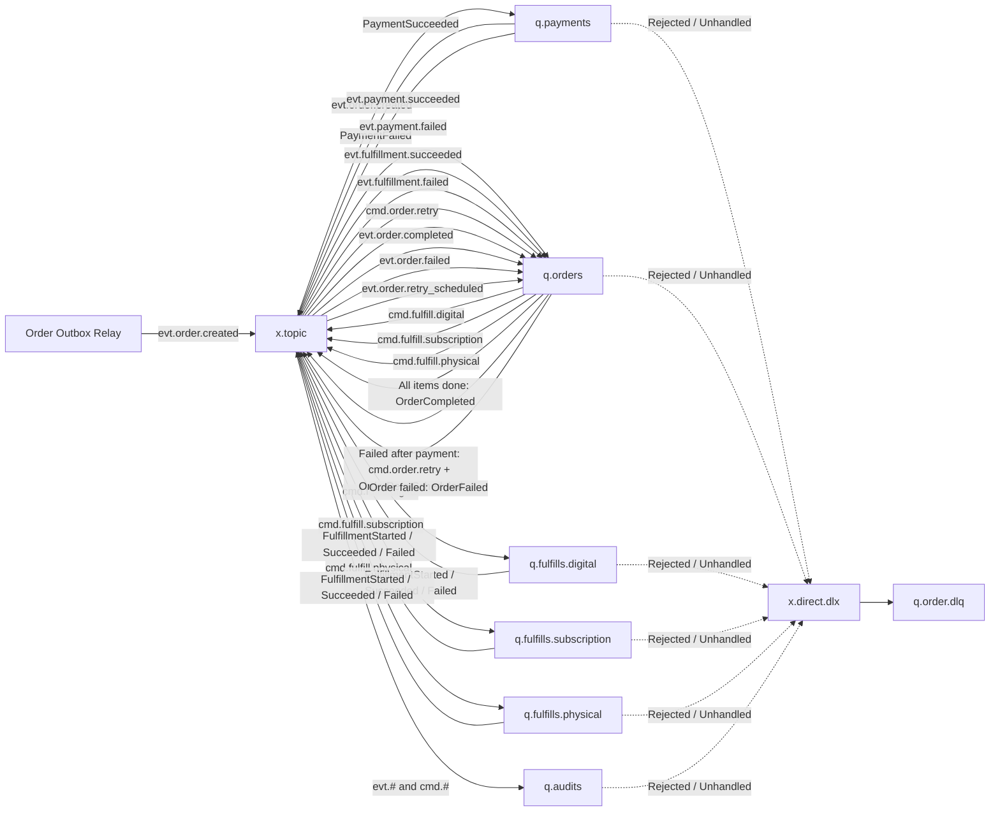

# Contracts

Here you can see all external/internal contracts which app uses.

## Endpoints

### Global

- [ ] `GET /health` Check application + PostgreSQL + RabbitMQ connectivity.

### Products

The products seeded to database by a script, so no need creating endpoint

- [ ] `GET /products` Get list of products
- [ ] `GET /products/:id` Get product by id

### Orders

- [ ] `POST /orders` Create new order
- [ ] `GET /orders` List of orders
- [ ] `GET /orders/:id` Retrieve order by id
- [ ] `GET /orders/:id/payment` Inspect payment status
- [ ] `POST /orders/:id/retry` Retry a failed order
- [ ] `GET /orders/:id/events` List of order's events

---

## Events

- `OrderCreated`
- `PaymentSucceeded`
- `PaymentFailed`
- `FulfillmentStarted`
- `FulfillmentSucceeded`
- `FulfillmentFailed`
- `OrderCompleted`
- `OrderFailed`
- `OrderRetryScheduled`

---

## Exchanges

- `x.topic` **Durable**
- `x.direct.dlx` **Durable**

---

## Routing keys

### Orders

- `cmd.order.retry` Publish if order failed after user payed
- `evt.order.completed` Publish when order cycle completed
- `evt.order.failed` Publish when order cycle failed
- `evt.order.created` Publish with order outbox relay
- `evt.order.retry_scheduled` Publish when failed after payment(for audit)

### Payment

- `evt.payment.succeeded` Publish after user payment
- `evt.payment.failed` Publish after user payment

### Items Fulfillment

- `evt.fulfillment.started`
- `evt.fulfillment.failed`
- `evt.fulfillment.succeeded`
- `cmd.fulfill.digital` Published by order after success payment
- `cmd.fulfill.subscription` Published by order after success payment
- `cmd.fulfill.physical` Published by order after success payment

---

## Queues

- `q.orders`
  - `evt.payment.failed` Update order's status
  - `evt.payment.succeeded` Update order's status
  - `evt.fulfillment.failed` Retry it if user payed
  - `evt.fulfillment.succeeded` Done
  - `cmd.order.retry` Retry order

- `q.payments`
  - `evt.order.created` Create payment url

- `q.fulfills.digital`
  - `cmd.fulfill.digital` Update product's state

- `q.fulfills.subscription`
  - `cmd.fulfill.subscription` Update product's state

- `q.fulfills.physical`
  - `cmd.fulfill.physical` Update product's state

- `q.audits`
  - `evt.#` Store event
  - `cmd.#` Store command

- `q.order.dlq`
  - `x.direct.dlx` **Direct**, log

## Diagram

