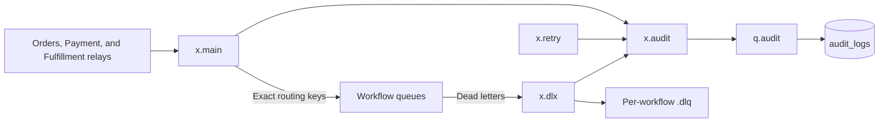

# HTTP and RabbitMQ contracts

## HTTP

The API uses `/api/v1` for feature routes. `GET /api/ping` is version-neutral and returns `data: "pong"` as a reachability check. Successful JSON responses use `{ success: true, data, timestamp }`. Examples below show the contents of `data`. Delete responses have an empty body, and the audit stream uses server-sent events. Monetary amounts are nonnegative 64-bit integers in IRR minor units, serialized as decimal strings.

| Method and path | Success | Response |
| --- | --- | --- |
| `GET /api/ping` | `200` | `"pong"` |
| `GET /api/v1/products` | `200` | Array sorted by product ID, with `limit` (1–100, default 25) and `offset` (0–2147483647, default 0). |
| `POST /api/v1/products` | `201` | Created product and its initial stock for physical products. |
| `GET /api/v1/products/:id` | `200` | Product, including `availableStock` when an inventory row exists. |
| `DELETE /api/v1/products/:id` | `204` | Deletes the product and any inventory row. Existing order items keep their snapshots. |
| `POST /api/v1/orders` | `201` | Order ID and initial status. Requires `Idempotency-Key`. |
| `GET /api/v1/orders` | `200` | `{ orders, page, per_page }`, sorted by creation time and ID descending. Optional `customerId` and `status` filters. |
| `GET /api/v1/orders/:id` | `200` | Order summary, items, latest payment, and shipments. |
| `POST /api/v1/orders/:id/retry` | `202` | Queues eligible failed items. Requires `Idempotency-Key`. |
| `GET /api/v1/payments?orderId=<uuid>` | `200` | Latest payment, including checkout preparation state. |
| `GET /api/v1/payments/:paymentId` | `200` | Mock payment details. |
| `POST /api/v1/payments/:paymentId/callback` | `200` | Mock payment settlement result. |
| `POST /api/v1/payments/:paymentId/retry` | `201` | `{ paymentId }` for the successor attempt. |
| `GET /api/v1/audit` | `200` | `{ items, nextCursor }` for stored messages. |
| `GET /api/v1/audit/stream` | `200` | Live audit records over SSE. |

Order and audit pages default to `page=1&per_page=10`. The range of `per_page` is 1–100. Invalid UUIDs and fields rejected by DTO validation return `400`. Lookups by ID return `404` for missing resources. Structured payment and product errors expose `errorCode`, while idempotency and fulfillment retry errors expose `code`.

### Products

Send `name`, `type` (`PHYSICAL`, `DIGITAL`, or `SUBSCRIPTION`), and `unitPriceMinor` to create a product. Only physical products accept `initialStock`, an integer from 0 to 2147483647 that defaults to zero. Only digital products accept the optional `digitalMetadata` object. Subscriptions require `subscriptionDays`, a positive 32-bit integer. Responses include `id`, `name`, `type`, `unitPriceMinor`, `currency`, and applicable optional fields. Product lists omit stock. The API has no stock update route.

### Create an order

Send 1–100 distinct products with UUIDs and integer quantities from 1 to 100. Orders reads the catalog and calculates prices on the server. The current stock check happens during order creation, and the atomic reservation happens during physical fulfillment after payment. An unknown product returns `404`. The current implementation reports `500` when the requested physical quantity exceeds the catalog's available stock or the order total overflows the supported amount.

The following request uses two products from the seed catalog.

```json
{
  "customerId": "550e8400-e29b-41d4-a716-446655440000",
  "items": [
    { "productId": "019338a0-0000-7000-8000-000000000001", "quantity": 1 },
    { "productId": "019338a0-0000-7000-8000-000000000002", "quantity": 1 }
  ]
}
```

The `201` response contains `id`, `customerId`, `status: "PENDING_PAYMENT"`, `currency`, and `createdAt` in `data`. Payment preparation runs asynchronously.

#### Idempotency keys

Order creation and fulfillment retry require a key of 1–255 printable ASCII characters. Use a fresh key for each new operation. Send the same key, method, URL, and JSON body to replay a completed operation within its 24-hour retention window. A replay returns the stored status and body with `Idempotent-Replayed: true`. Matching requests still in progress return `409 IDEMPOTENCY_KEY_IN_USE` with `Retry-After`. Reusing an active key for a different request returns `422 IDEMPOTENCY_KEY_REUSED`. Missing or invalid keys return `400`. [Idempotency transaction and crash window](design.md#create-an-order-idempotently)

### Checkout and callback

Poll `GET /api/v1/payments?orderId=<uuid>` after creating an order. It returns `404` until a payment attempt exists. An attempt with a checkout still being prepared returns `PENDING` and a null `checkoutUrl`. Only attempt 1 hides its `paymentId` during preparation. When checkout is ready, `data` looks like this.

```json
{
  "paymentId": "019b3b23-292a-7db4-89c0-196e12d2948a",
  "status": "AWAITING_CUSTOMER",
  "checkoutUrl": "http://localhost:7000/mock-payments/019b3b23-292a-7db4-89c0-196e12d2948a",
  "amountMinor": "15800",
  "currency": "IRR"
}
```

The mock gateway generates a localhost `/mock-payments/...` URL as a simulated checkout identifier. For the demo, use `GET /api/v1/payments/:paymentId` on the API origin to view the payment. This adds `orderId` to the payment fields.

Send `{ "result": "SUCCESS" }`, `{ "result": "DECLINE" }`, or `{ "result": "TIMEOUT" }` to `POST /api/v1/payments/:paymentId/callback`. An identical repeat returns the stored result. A conflicting result returns `409` with `errorCode: "PAYMENT_ALREADY_FINAL"`. A callback while checkout is being prepared also returns `409`. Invalid bodies return `400`. Unknown payments and payments from another gateway return `404` on both mock routes.

Settled payments have a null `checkoutUrl`. `DECLINE` and `TIMEOUT` produce `FAILED` with a `failureCode` of `PAYMENT_DECLINED` or `PAYMENT_TIMED_OUT`. Order status updates asynchronously from payment events.

### Retry payment

Send `POST /api/v1/payments/:paymentId/retry` with the failed attempt's ID. The `201` returns `{ paymentId }` for the successor. Repeating the request with the same failed attempt ID returns the same successor, including after it settles. An unknown payment returns `404`. An attempt that has yet to fail returns `409` with `errorCode: "PAYMENT_RETRY_NOT_ELIGIBLE"`.

### Read an order

Order summaries contain `id`, `customerId`, `status`, `totalMinor`, `currency`, `createdAt`, and `updatedAt`. Order details also contain the following fields.

| Field | Contents |
| --- | --- |
| `items` | Objects with `id`, `productId`, `productType`, `quantity`, `unitPriceMinor`, `status`, `attempts`, and nullable `failureCode`. |
| `payment` | Same fields as the latest-payment lookup, or `null` before the first attempt. |
| `shipments` | Objects with `id`, `orderItemId`, `quantity`, and `createdAt`. |

The payment and shipment queries can reflect newer state than the order and its items while Orders is still receiving broker messages. [Order and item states](design.md#states)

### Retry fulfillment

For a `FULFILLMENT_FAILED` order, send `{}` to retry all eligible items or `{ "itemId": "<uuid>" }` for a single item. Eligibility requires a failed item with `OUT_OF_STOCK` and room to increment its attempt counter. A `202` returns `{ orderId, status: "FULFILLING", itemIds }`. A missing order or a requested item outside the order returns `404`. An ineligible retry returns `409` with `code: "RETRY_NOT_ELIGIBLE"`. Reuse the original `Idempotency-Key` and body to replay a successful retry.

## Order history

`GET /api/v1/audit` lists records by ingestion time and ID descending. Pass `nextCursor` back as `cursor` to continue from the last record, or use page-based pagination. A supplied cursor takes precedence over the page offset. Each record includes `id`, `event` (routing key), `createdAt` (ingestion time), and `payload` (original message body). Filter an order's records on the client using `payload.orderId`.

`GET /api/v1/audit/stream` emits newly inserted records on the app instance processing the delivery. Each SSE message uses the audit record ID and the same record shape in its data. Use the list endpoint for stored history.

## RabbitMQ

Workflow publishers use the durable topic exchange `x.main`. The following workflow queues are durable quorum queues with exact bindings.

| Routing key | Workflow queue | Work |
| --- | --- | --- |
| `evt.order.created` | `q.payment.process` | Prepare checkout. |
| `evt.payment.started`, `evt.payment.succeeded`, `evt.payment.failed` | `q.orders.payment` | Record payment attempts and apply their outcomes. |
| `cmd.digital.grant` | `q.fulfills.digital` | Record a digital grant. |
| `cmd.subscription.activate` | `q.fulfills.subscription` | Activate or extend a subscription. |
| `cmd.physical.fulfill` | `q.fulfills.physical` | Reserve stock and create a shipment. |
| `evt.digital.succeeded`, `evt.digital.failed`, `evt.subscription.succeeded`, `evt.subscription.failed`, `evt.physical.succeeded`, `evt.physical.failed` | `q.orders.fulfillment` | Apply outcomes to the matching item attempt. |

The JSON body is the payload directly. AMQP properties carry the outbox ID as `messageId`, `application/json` as `contentType`, and the occurrence time as a Unix timestamp in seconds. The `x-occurred-at` header carries the same time in ISO 8601. A per-publication `x-publish-token` matches mandatory returns to publish attempts. Outbox retries keep the same body and message ID.

### Commands

All three fulfillment commands include `orderId`, `orderItemId`, `attemptNo`, `customerId`, `productId`, and `quantity`. The subscription command adds `durationDays` from the item snapshot, which can be null for a missing snapshot. A fulfillment retry uses the same snapshot, the next attempt number, and a new outbox message ID.

### Events

| Routing key | Fields |
| --- | --- |
| `evt.order.created` | `orderId`, `customerId`, `totalMinor`, `currency`, `itemCount` |
| `evt.order.completed` | `orderId`, `completedAt` |
| `evt.order.failed` | `orderId`, `reason` |
| `evt.order.retry_scheduled` | `orderId`, `orderItemId`, `reason`, `attemptNo` |
| `evt.payment.started` | `orderId`, `paymentId`, `attemptNo` |
| `evt.payment.succeeded` | `orderId`, `paymentId`, `attemptNo`, `amountMinor`, `currency` |
| `evt.payment.failed` | `orderId`, `paymentId`, `attemptNo`, `errorCode`, `reason` |
| `evt.digital.started`, `evt.subscription.started`, `evt.physical.started` | `orderId`, `orderItemId`, `attemptNo` |
| `evt.digital.succeeded`, `evt.subscription.succeeded`, `evt.physical.succeeded` | `orderId`, `orderItemId`, `attemptNo` |
| `evt.digital.failed`, `evt.subscription.failed`, `evt.physical.failed` | `orderId`, `orderItemId`, `attemptNo`, `errorCode` |
| `evt.physical.shipment_created` | `orderId`, `orderItemId`, `attemptNo`, `shipmentId` |

### Audit and dead letters

`x.audit` is a durable fanout exchange bound from `x.main`, `x.retry`, and `x.dlx`. Its durable queue `q.audit` receives both commands and events. Workflow retries use delayed redelivery on the source quorum queue. The app also declares `x.retry` as a direct exchange. Each work queue has a quorum dead-letter queue bound to `x.dlx` with the same name plus `.dlq`.



A mandatory publish can succeed through the audit binding alone. The application declares workflow bindings at startup. See [Delivery and recovery](design.md#delivery-and-recovery) for publisher confirms, acknowledgement, and retry behavior.
