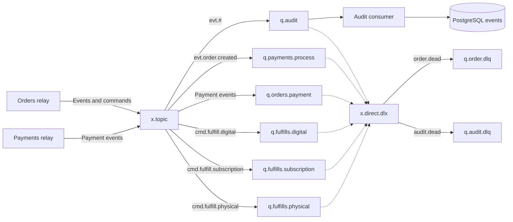

# Contracts

## HTTP

| Method and path                           | Response                                                                                                           |
| ----------------------------------------- | ------------------------------------------------------------------------------------------------------------------ |
| `GET /health`                             | PostgreSQL, RabbitMQ, and Redis report `up` or `down`. `503` if PostgreSQL is down, `200` otherwise.               |
| `GET /products`                           | ID, name, type, unit price, and optional subscription duration or digital metadata.                                |
| `GET /products/:id`                       | Product or `404`. Cache catalog details in Redis. Read physical stock from PostgreSQL when included.               |
| `POST /orders`                            | `201` with order ID and initial status before fulfillment.                                                         |
| `GET /orders`                             | `{ orders, limit, offset }`. Optional `customerId` and `status` filters. Sort by creation time and ID, descending. |
| `GET /orders/:id`                         | Order, items, latest payment attempt, and shipments, or `404`.                                                     |
| `GET /orders/:id/payment`                 | Latest checkout and payment status, or `404` for an unknown order.                                                 |
| `POST /orders/:id/payment/retry`          | `201` with the new payment ID for a failed attempt.                                                                |
| `GET /mock-payments/:paymentId`           | Mock checkout session, or `404`.                                                                                   |
| `POST /mock-payments/:paymentId/callback` | Record a simulated gateway result and return the payment.                                                          |
| `POST /orders/:id/retry`                  | `202` with order status and queued item IDs.                                                                       |
| `GET /orders/:id/events`                  | `{ events, limit, offset }` in occurrence order, or `404`.                                                         |

Successful reads return `200`. Pagination defaults to `limit=25` (1–100) and `offset=0` (nonnegative). Prices and totals use minor units as decimal strings with `currency: "IRR"`.

Order creation, payment retry, and fulfillment retry return `429` when the per-IP limit is exceeded. [Redis behavior](design.md#redis-and-operational-checks)

### Create an order

Send `X-Idempotency-Key` and a JSON body.

```json
{
  "customerId": "c-42",
  "items": [
    { "productId": "ebook-1", "quantity": 1 },
    { "productId": "mug-1", "quantity": 1 }
  ]
}
```

Customer and product IDs are opaque strings. Accept 1–100 distinct products and integer quantities of 1–100, with quantity 1 for digital items. The server supplies types, prices, and totals.

```json
{
  "orderId": "69ab9e38-7272-432b-973c-ffa67a7d0c37",
  "status": "PENDING_PAYMENT"
}
```

The same customer, key, and normalized request replay the original `201` body. Read current status with `GET /orders/:id`. Different input with the same key returns `409 IDEMPOTENCY_KEY_CONFLICT`. Missing keys, invalid fields, and unknown products return `400`.

### Checkout and callback

Poll `GET /orders/:id/payment` after creating an order. It returns the latest attempt. While the first checkout is being prepared, a known order returns `200` with the order amount and currency, `status: "PENDING"`, `paymentId: null`, and `checkoutUrl: null`. When it is ready, the response looks like this.

```json
{
  "paymentId": "019b3b23-292a-7db4-89c0-196e12d2948a",
  "status": "AWAITING_CUSTOMER",
  "checkoutUrl": "http://localhost:3000/mock-payments/019b3b23-292a-7db4-89c0-196e12d2948a",
  "amountMinor": "2499",
  "currency": "IRR"
}
```

The mock URL returns the payment ID, order ID, amount, currency, and status as JSON. To settle it in the demo, call `POST /mock-payments/:paymentId/callback` with `{ "result": "SUCCESS" }`, `{ "result": "DECLINE" }`, or `{ "result": "TIMEOUT" }`. The callback returns `200` with the payment. An identical repeat returns the stored result. A conflicting result returns `409 PAYMENT_ALREADY_FINAL`. An invalid result returns `400` and an unknown payment returns `404`.

Settled payments have `checkoutUrl: null`. `DECLINE` and `TIMEOUT` produce `FAILED` with a `failureCode` of `PAYMENT_DECLINED` or `PAYMENT_TIMED_OUT`, respectively. Order status updates asynchronously from payment events.

### Retry payment

Once the latest payment attempt is `FAILED`, send `POST /orders/:id/payment/retry` with `{ "failedPaymentId": "<uuid>" }`. A `201` returns `{ paymentId }` for the new checkout. Read the latest checkout URL from `GET /orders/:id/payment`. Repeating the same request returns the same `201` and payment ID, even if the new attempt has since settled.

An unknown payment or one outside the order returns `404`. A malformed payment ID returns `400`. An attempt that has yet to fail or has succeeded returns `409 PAYMENT_RETRY_NOT_ELIGIBLE`.

### Read an order

Order details include the latest attempt from Payments. Order status can lag while Orders receives its events.

```json
{
  "orderId": "69ab9e38-7272-432b-973c-ffa67a7d0c37",
  "customerId": "c-42",
  "status": "FULFILLMENT_FAILED",
  "totalMinor": "2499",
  "currency": "IRR",
  "items": [
    {
      "itemId": "ba565d1f-cc5c-4c5b-a194-c05f398a2768",
      "productId": "ebook-1",
      "type": "DIGITAL",
      "quantity": 1,
      "unitPriceMinor": "1200",
      "status": "SUCCEEDED",
      "attempt": 1,
      "failureCode": null
    },
    {
      "itemId": "74b380ce-49e0-4661-98af-1c0977bb87ca",
      "productId": "mug-1",
      "type": "PHYSICAL",
      "quantity": 1,
      "unitPriceMinor": "1299",
      "status": "FAILED",
      "attempt": 1,
      "failureCode": "OUT_OF_STOCK"
    }
  ],
  "payment": {
    "paymentId": "019b3b23-292a-7db4-89c0-196e12d2948a",
    "status": "SUCCEEDED",
    "checkoutUrl": null,
    "amountMinor": "2499",
    "currency": "IRR"
  },
  "shipments": []
}
```

The nested payment shows the latest attempt and uses the same status shape as the payment endpoint. Shipments include shipment ID, item ID, and creation time.

### Retry fulfillment

For a `FULFILLMENT_FAILED` order, send `{}` to retry all eligible items or `{ "itemId": "<uuid>" }` for one. A `202` returns `{ orderId, status: "FULFILLING", itemIds }`. A missing order or item outside the order returns `404`. An ineligible retry returns `409 RETRY_NOT_ELIGIBLE`.

## Order history

`GET /orders/:id/events` reads Audit entries ordered by `occurred_at`, then event ID. The original message ID is the event ID. Each response row includes event ID, order ID, type, occurrence time, and the payment or item ID when present.

| Event type             | Routing key                 |
| ---------------------- | --------------------------- |
| `OrderCreated`         | `evt.order.created`         |
| `OrderCompleted`       | `evt.order.completed`       |
| `OrderFailed`          | `evt.order.failed`          |
| `PaymentStarted`       | `evt.payment.started`       |
| `PaymentSucceeded`     | `evt.payment.succeeded`     |
| `PaymentFailed`        | `evt.payment.failed`        |
| `FulfillmentStarted`   | `evt.fulfillment.started`   |
| `FulfillmentSucceeded` | `evt.fulfillment.succeeded` |
| `FulfillmentFailed`    | `evt.fulfillment.failed`    |
| `ShipmentCreated`      | `evt.shipment.created`      |
| `RetryScheduled`       | `evt.retry.scheduled`       |

Payment events include the payment ID and its positive integer `attempt`. `PaymentFailed` includes the failure code. Item attempt events include the attempt and any failure code. `RetryScheduled` includes the next attempt and scheduled time. `ShipmentCreated` includes the shipment ID.

## RabbitMQ

Publish events and commands to the durable topic exchange `x.topic`. Workflow queues use exact bindings.

| Routing key                | Durable quorum queue      | Work                                     |
| -------------------------- | ------------------------- | ---------------------------------------- |
| `evt.order.created`        | `q.payments.process`      | Prepare checkout for the new order.      |
| `evt.payment.started`      | `q.orders.payment`        | Record the new payment attempt.          |
| `evt.payment.succeeded`    | `q.orders.payment`        | Start fulfillment.                       |
| `evt.payment.failed`       | `q.orders.payment`        | Fail the order and skip its items.       |
| `cmd.fulfill.digital`      | `q.fulfills.digital`      | Record a digital access grant.           |
| `cmd.fulfill.subscription` | `q.fulfills.subscription` | Activate or extend the subscription.     |
| `cmd.fulfill.physical`     | `q.fulfills.physical`     | Reserve inventory and record a shipment. |

`OrderCreated` carries `orderId` and `amountMinor` as a decimal string so Payments can create checkout from the event. Fulfillment commands contain `orderId`, `itemId`, and a positive integer `attempt`. An item retry creates a new message ID and increments the attempt.

### Audit queue

Bind the durable quorum queue `q.audit` to `x.topic` with `evt.#`. The same `evt.order.created` publish reaches checkout and audit. A confirm can succeed with only the audit binding present, so declare the exact workflow bindings and test checkout, payment outcomes, and history delivery. [RabbitMQ topic exchanges](https://www.rabbitmq.com/docs/exchanges#topic) · [Publisher confirms](https://www.rabbitmq.com/docs/confirms)

Publish JSON with `occurredAt` set when the event occurs or the command is created. Use an ISO 8601 timestamp and the outbox ID as the AMQP `messageId`. Republishing preserves the body and ID. Event payloads include `type` from the event table and the relevant order, payment, or item IDs.

Use the durable direct exchange `x.direct.dlx` for dead letters. Bind `q.order.dlq` with `order.dead` for worker queues and `q.audit.dlq` with `audit.dead` for `q.audit`. Set `delivery-limit=20`, `dead-letter-strategy=at-least-once`, and `overflow=reject-publish` on the source queues. Declare and check the topology before processing work.



See [Delivery and recovery](design.md#delivery-and-recovery) for confirm, acknowledgement, and redrive behavior.
