# Class diagram

This diagram shows the target dependencies. The repository interfaces belong to the workflow modules. The persistence classes implement those interfaces and handle Prisma access.

```mermaid
classDiagram
    namespace OrdersModule {
        class OrdersController
        class OrderRateLimitGuard
        class OrderLifecycleService
        class OrdersQueryService
        class OrderPaymentConsumer
        class FulfillmentConsumer
        class OutboxRelay
        class OrdersRepository {
            <<interface>>
        }
        class CatalogReader {
            <<interface>>
        }
    }
    namespace ProductsModule {
        class ProductsController
        class ProductsService
        class ProductsDataAccess
    }
    namespace PaymentsModule {
        class OrderCreatedConsumer
        class MockPaymentsController
        class PaymentsService
        class PaymentsRepository {
            <<interface>>
        }
    }
    namespace FulfillmentModule {
        class FulfillmentService
        class ItemProcessor {
            <<interface>>
            +fulfill(tx TransactionCtx, item) FulfillmentResult
        }
        class FulfillmentRepository {
            <<interface>>
        }
        class StockReservation {
            <<interface>>
        }
        class DigitalProcessor
        class SubscriptionProcessor
        class PhysicalProcessor
    }
    class TransactionManager {
        <<abstract>>
    }
    class OutboxWriter {
        <<interface>>
    }
    namespace PersistenceAdapters {
        class PrismaService
        class PrismaTransactionManager
        class PrismaOrdersRepository
        class PrismaPaymentsRepository
        class PrismaFulfillmentRepository
        class PrismaOutboxRepository
    }
    namespace RabbitMqModule {
        class RabbitMqService
    }
    namespace RedisModule {
        class RedisService
    }
    namespace HealthModule {
        class HealthController
        class HealthService
        class DatabaseReadinessCheck
    }
    namespace AuditModule {
        class AuditConsumer
        class AuditService
        class AuditDataAccess
    }

    OrdersController --> OrderLifecycleService : creates and retries orders
    OrdersController --> OrdersQueryService : reads orders
    OrdersController ..> OrderRateLimitGuard : create and retry
    OrderRateLimitGuard --> RedisService : counts requests per IP
    ProductsController --> ProductsService : handles catalog CRUD
    ProductsService --> ProductsDataAccess : delegates queries and writes
    ProductsDataAccess --> PrismaService
    ProductsService --> RedisService : caches catalog and locks refills
    ProductsService ..|> CatalogReader
    ProductsService ..|> StockReservation
    OrdersQueryService --> OrdersRepository : reads order details and history
    OrderPaymentConsumer --> OrderLifecycleService : applies payment outcome
    FulfillmentConsumer --> OrderLifecycleService : claims and settles items
    OrderPaymentConsumer --> RabbitMqService : consumes payment outcomes
    FulfillmentConsumer --> RabbitMqService : consumes and acknowledges
    OrderCreatedConsumer --> RabbitMqService : consumes order creation events
    OrderCreatedConsumer --> PaymentsService : prepares checkout
    MockPaymentsController --> PaymentsService : reads checkout and settles callback
    PaymentsService --> TransactionManager : runs payment transactions
    PaymentsService --> PaymentsRepository : reads and saves payments
    PaymentsService --> OutboxWriter : stages payment events
    OrderLifecycleService --> TransactionManager : runs order transactions
    OrderLifecycleService --> OrdersRepository : claims requests and saves orders and items
    OrderLifecycleService --> CatalogReader : loads product snapshots with tx
    OrderLifecycleService --> OutboxWriter : stages events and commands
    OrderLifecycleService --> FulfillmentService : fulfills with tx
    FulfillmentService ..> ItemProcessor : dispatches by item type
    DigitalProcessor ..|> ItemProcessor
    SubscriptionProcessor ..|> ItemProcessor
    PhysicalProcessor ..|> ItemProcessor
    DigitalProcessor --> FulfillmentRepository : saves access grants
    SubscriptionProcessor --> FulfillmentRepository : extends subscriptions
    PhysicalProcessor --> FulfillmentRepository : saves shipments
    PhysicalProcessor --> StockReservation : reserves stock with tx
    PrismaOrdersRepository ..|> OrdersRepository
    PrismaPaymentsRepository ..|> PaymentsRepository
    PrismaFulfillmentRepository ..|> FulfillmentRepository
    PrismaOutboxRepository ..|> OutboxWriter
    PrismaTransactionManager ..|> TransactionManager
    PrismaOrdersRepository --> PrismaService
    PrismaPaymentsRepository --> PrismaService
    PrismaFulfillmentRepository --> PrismaService
    PrismaOutboxRepository --> PrismaService
    PrismaTransactionManager --> PrismaService : opens Prisma transaction
    OutboxRelay --> TransactionManager : runs relay transaction
    OutboxRelay --> PrismaOutboxRepository : claims and updates pending messages
    OutboxRelay --> RabbitMqService : publishes events and commands
    AuditConsumer --> RabbitMqService : consumes and acknowledges q.audit
    AuditConsumer --> AuditService : records events
    AuditService --> AuditDataAccess : inserts messages into events
    AuditDataAccess --> PrismaService
    HealthController --> HealthService
    HealthService --> DatabaseReadinessCheck : checks readiness
    DatabaseReadinessCheck --> PrismaService
    HealthService --> RabbitMqService : checks connectivity
    HealthService --> RedisService : checks connectivity
```

`AppModule` composes the modules. Within a workflow transaction, `OrderLifecycleService` and `PaymentsService` pass the same `TransactionCtx` from `TransactionManager` to every participating persistence operation. This includes calls delegated to item processors and Products data access. [Transactions](../design.md#transaction-boundaries) · [Audit history](../design.md#audit-history)
