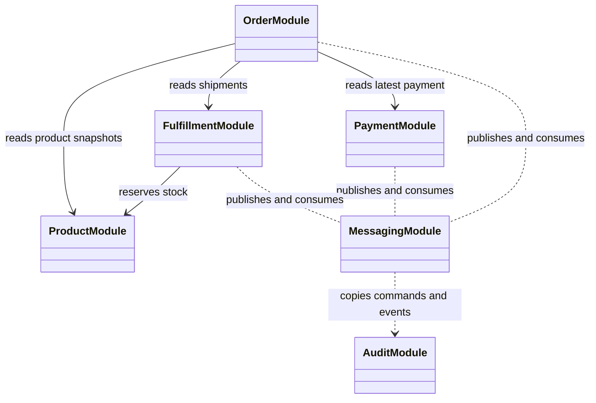

# Module diagram

Solid arrows show synchronous calls through module-owned interfaces. Dashed arrows show RabbitMQ publishing and consumption.

Orders publishes item commands and applies outcomes. Product owns the stock update, which commits with the shipment and Fulfillment's outcome. Orders, Payment, and Fulfillment each relay their own outbox.

[Module layout](../design.md#module-layout) · [Transaction boundaries](../design.md#transaction-boundaries) · [Sequence diagrams](fulfill_order.md) · [Data model](erd.md#mvp-model)
