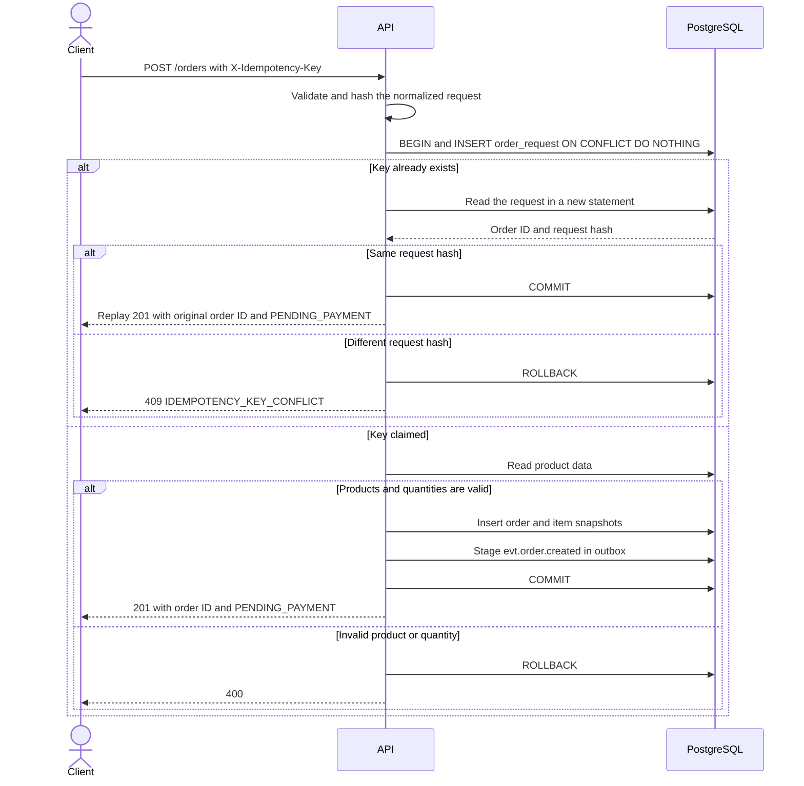
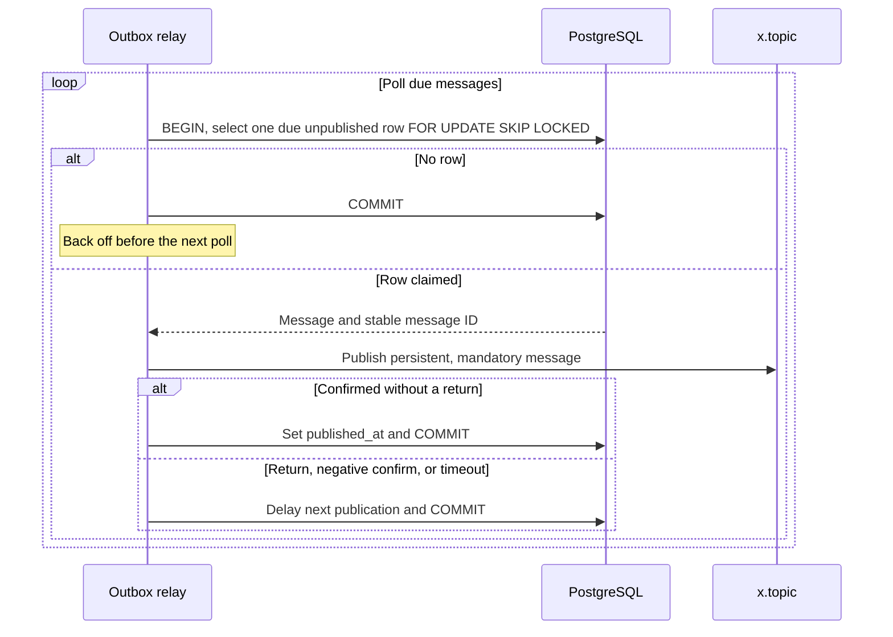

# Creating an order

## Store the order

The PostgreSQL calls represent work delegated through repository ports and Products data access. `TransactionManager.runTx` supplies the single transaction context used for the request claim, product reads, order writes, and outbox entry.

[Create-order transaction](../design.md#create-an-order-idempotently)

## Relay outbox messages

The relay uses `TransactionManager.runTx` and the outbox persistence adapter to claim and update a row in one transaction.

[Delivery and recovery](../design.md#delivery-and-recovery)
