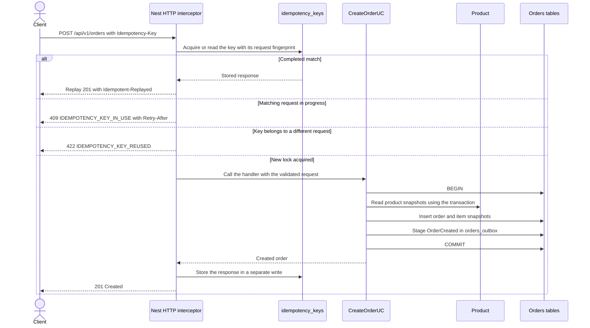
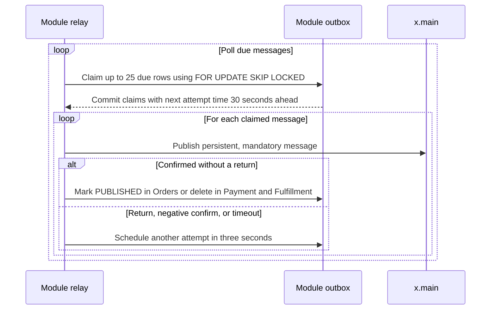

# Creating an order

## Store the order

The Nest HTTP interceptor looks up the request in the shared `idempotency_keys` table before calling Orders. A completed replay skips the use case.

[Create-order transaction](../design.md#create-an-order-idempotently)

## Relay outbox messages

Orders, Payments, and Fulfillment each run this loop against their own outbox table.

[Delivery and recovery](../design.md#delivery-and-recovery)
