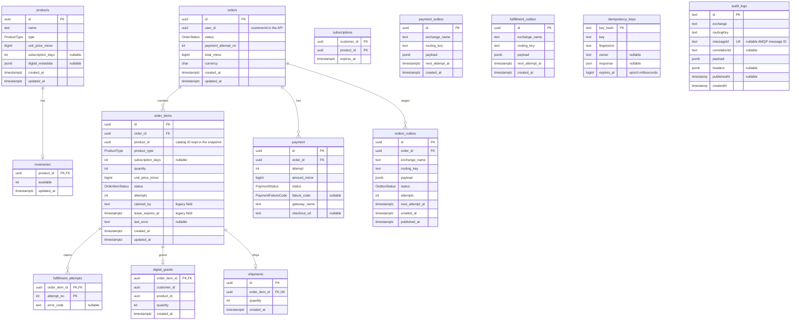

# Entity relationship diagram

## MVP model

This diagram uses PostgreSQL table and column names from the Prisma schema and migrations. Lines show database foreign keys. The ownership table also lists the records whose relationships are carried in message payloads or snapshots.

| Owner | Tables |
| --- | --- |
| Product | `products`, `inventories` |
| Orders | `orders`, `order_items`, `orders_outbox` |
| Payment | `payment`, `payment_outbox` |
| Fulfillment | `fulfillment_attempts`, `digital_grants`, `subscriptions`, `shipments`, `fulfillment_outbox` |
| Audit | `audit_logs` |
| HTTP idempotency | `idempotency_keys` |

The caller supplies a customer UUID. Each order item snapshots the product type, unit price, and subscription duration. Product IDs on order items, digital grants, and subscriptions are logical references. Deleting a product cascades to inventory. Existing orders retain their snapshots. Money is represented as nonnegative `BIGINT` minor units and serialized as decimal strings. IRR is stored on orders and supplied by the payment and product money model.

## Constraints and indexes

| Area | Rule and purpose |
| --- | --- |
| Inventory | The product ID is the inventory primary key. A database check enforces `available >= 0`. Product's conditional update reserves stock in the shipment transaction. |
| Order items | API validation requires distinct products and quantities of 1–100. A database check requires a positive subscription-day snapshot when present. Indexes on `order_id` and `product_id` support lookups. Current fulfillment claims use `fulfillment_attempts`. The item lease columns and their index remain in the schema. |
| Payment | The unique `(order_id, attempt)` key identifies each attempt and supports querying the latest one. A partial unique index on `order_id` for `AWAITING_CUSTOMER` and `SUCCEEDED` permits one active or successful attempt. Database checks require a positive attempt, a nonnegative amount, and a failure code exactly when the status is `FAILED`. |
| Fulfillment | The `(order_item_id, attempt_no)` primary key deduplicates commands and attempt numbers must be positive. Grants and shipments are unique per order item and check for positive quantities. The subscription key `(customer_id, product_id)` supports atomic expiry extensions. |
| Outboxes | Orders indexes status and next attempt time, as well as order ID, and keeps published rows. Payment and Fulfillment index `(next_attempt_at, id)` and delete confirmed rows. An outbox row ID becomes the AMQP message ID. |
| HTTP idempotency | The `key_hash` primary key selects one active request per key. The expiry index supports cleanup, and an expired row can be reused on the next request with the same key. |
| Audit | The unique optional `messageId` deduplicates identified deliveries. Indexes cover exchange and routing key, correlation ID, and ingestion time. Order, payment, and item IDs are in the payload. |
| Order listing | Indexes cover `(created_at DESC, id DESC)`, `(status, created_at DESC, id DESC)`, `status`, and `(user_id, created_at DESC)`. |

[Order and item states](../design.md#states) · [Transaction boundaries](../design.md#transaction-boundaries) · [RabbitMQ event fields](../contracts.md#events)
