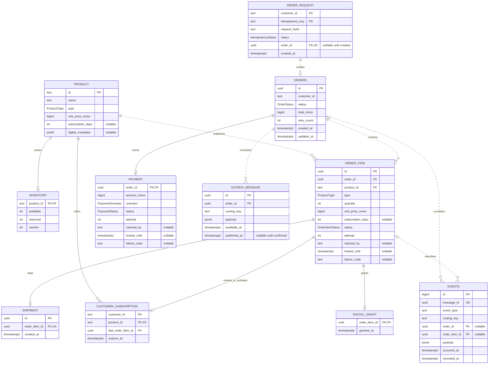
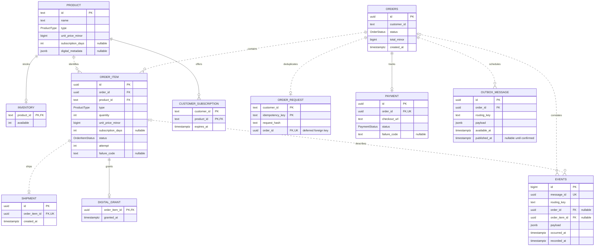

# Entity relationship diagram

## Earlier schema sketches

The [MVP model](#mvp-model) below describes the current checkout flow.

```mermaid
erDiagram
    PRODUCT ||--o| INVENTORY : stocks
    PRODUCT ||..o{ ORDER_ITEM : identifies
    PRODUCT ||--o{ CUSTOMER_SUBSCRIPTION : offers
    PRODUCT ||--o{ INVENTORY_RESERVATION : reserves
    ORDERS ||..o| ORDER_REQUEST : deduplicates
    ORDERS ||..o{ ORDER_ITEM : contains
    ORDERS ||--o| PAYMENT : tracks
    ORDERS |o..o{ EVENTS : correlates
    ORDERS ||..o{ OUTBOX_MESSAGE : schedules
    ORDER_ITEM |o..o{ EVENTS : describes
    ORDER_ITEM ||--o| DIGITAL_GRANT : grants
    ORDER_ITEM ||--o| SUBSCRIPTION_GRANT : extends
    ORDER_ITEM ||--o| INVENTORY_RESERVATION : locks
    ORDER_ITEM ||..o| SHIPMENT : ships
    CUSTOMER_SUBSCRIPTION ||--o{ SUBSCRIPTION_GRANT : records

    PRODUCT {
        uuid id PK
        text name
        ProductType type
        bigint unit_price_minor
        int subscription_days "nullable"
        jsonb digital_metadata "nullable"
        timestamptz created_at
        timestamptz updated_at
    }
    INVENTORY {
        uuid product_id PK, FK
        int available "CHECK >= 0"
        timestamptz updated_at
    }
    INVENTORY_RESERVATION {
        uuid order_item_id PK, FK
        text product_id FK
        int quantity "CHECK > 0"
        ReservationStatus status "RESERVED | COMMITTED | RELEASED"
        timestamptz created_at
        timestamptz updated_at
    }
    ORDERS {
        uuid id PK
        uuid customer_id
        OrderStatus status
        bigint total_minor
        int version "optimistic lock"
        timestamptz created_at
        timestamptz updated_at
    }
    ORDER_REQUEST {
        uuid customer_id PK
        text idempotency_key PK
        text request_hash
        uuid order_id FK, UK "nullable during insert or deferred FK"
        timestamptz created_at
    }
    ORDER_ITEM {
        uuid id PK
        uuid order_id FK
        text product_id FK
        ProductType type
        int quantity
        bigint unit_price_minor
        int subscription_days "nullable"
        OrderItemStatus status
        int attempt "fencing token"
        text locked_by "nullable"
        timestamptz lease_expires_at "nullable"
        text failure_code "nullable"
        timestamptz created_at
        timestamptz updated_at
    }
    PAYMENT {
        uuid order_id PK, FK
        bigint amount_minor
        PaymentScenario scenario
        PaymentStatus status
        text provider_ref UK "nullable"
        int attempt "fencing token"
        text locked_by "nullable"
        timestamptz lease_expires_at "nullable"
        text failure_code "nullable"
        timestamptz paid_at "nullable"
        timestamptz created_at
        timestamptz updated_at
    }
    DIGITAL_GRANT {
        uuid order_item_id PK, FK
        timestamptz granted_at
    }
    CUSTOMER_SUBSCRIPTION {
        text customer_id PK
        text product_id PK, FK
        timestamptz expires_at
        timestamptz updated_at
    }
    SUBSCRIPTION_GRANT {
        uuid order_item_id PK, FK
        text customer_id FK
        text product_id FK
        int days_granted
        timestamptz previous_expires_at "nullable"
        timestamptz new_expires_at
        timestamptz granted_at
    }
    SHIPMENT {
        uuid id PK
        uuid order_item_id FK, UK
        ShipmentStatus status "CREATED | CANCELLED"
        text tracking_number UK
        timestamptz created_at
        timestamptz updated_at
    }
    EVENTS {
        bigint id PK
        uuid message_id UK "nullable for sync API events"
        text routing_key
        uuid order_id FK "nullable"
        uuid order_item_id FK "nullable"
        jsonb payload
        timestamptz occurred_at
        timestamptz recorded_at
    }
    OUTBOX_MESSAGE {
        uuid id PK
        uuid order_id FK
        text routing_key
        jsonb payload
        int attempts "default 0"
        text last_error "nullable"
        timestamptz available_at
        timestamptz published_at "nullable until broker ack"
        timestamptz created_at
    }

```

## MVP model

Order creation commits the idempotency record, items, and `OrderCreated` outbox entry together. The payment worker creates checkout after it receives the event. The audit consumer records published events in `events`.

## Constraints and indexes

- **Catalog.** Seed one inventory row per physical product. Require nonnegative stock and prices. Subscription products and item snapshots require positive `subscription_days`.
- **Orders.** Store nonnegative IRR minor units as signed `BIGINT` and check the total fits. Require item quantities of 1–100, with 1 for digital items. Enforce unique `(order_id, product_id)` and snapshot product type, price, and subscription duration.
- **Idempotency.** Use `(customer_id, idempotency_key)` as the immediate primary key for `ON CONFLICT`. The unique `order_request.order_id` references `orders.id` with a `DEFERRABLE INITIALLY DEFERRED` foreign key so the key can be claimed first. [PostgreSQL constraint timing](https://www.postgresql.org/docs/current/sql-createtable.html)
- **Payment.** Generate a UUID v7 payment ID. Require a unique `order_id` for one checkout per order and use the immutable order total as its amount. Store `AWAITING_CUSTOMER`, `SUCCEEDED`, or `FAILED`.
- **Fulfillment.** A grant and a shipment each have at most one row per item. Subscriptions use the composite key `(customer_id, product_id)` for the atomic expiry update.
- **Events and outbox.** Deduplicate audit inserts by `events.message_id`. Index the order timeline on `(order_id, occurred_at, id)` and due outbox rows on `(available_at, id) WHERE published_at IS NULL`. If an item ID is present, require its matching order ID. Retain published outbox rows for recovery.
- **Order queries.** Index `(created_at DESC, id DESC)`, with variants prefixed by `customer_id` and `status`. The unique item index supports order-item lookups and the final-state check.

[State and locking rules](../design.md#transaction-boundaries) · [API types](../contracts.md#http)
