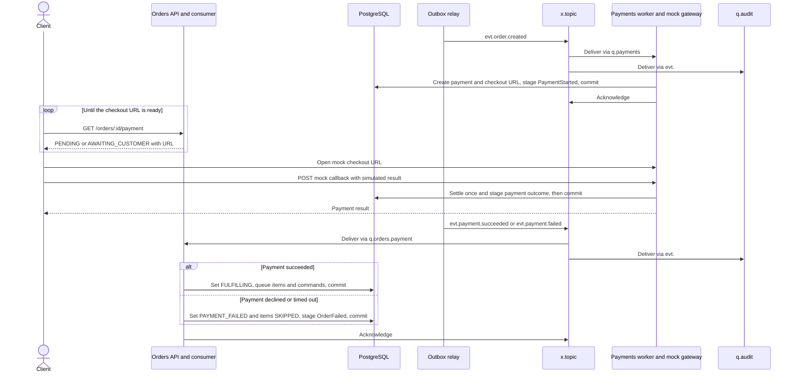
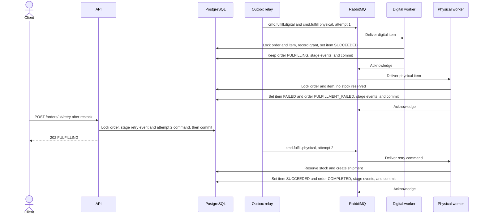

# Payment, fulfillment, and retry

Each database transaction shown below runs through `TransactionManager.runTx`. Repository adapters and Products data access use the same transaction context for all operations within that boundary.

## Checkout and payment

[Checkout and callback API](../contracts.md#checkout-and-callback)

## Item fulfillment and retry

A paid order grants digital access, then retries an out-of-stock physical item.

Attempt 2 reuses the payment and leaves the digital grant in place. Late deliveries of attempt 1 are stale. [Payment failure and timeout](../design.md#process-payment)
