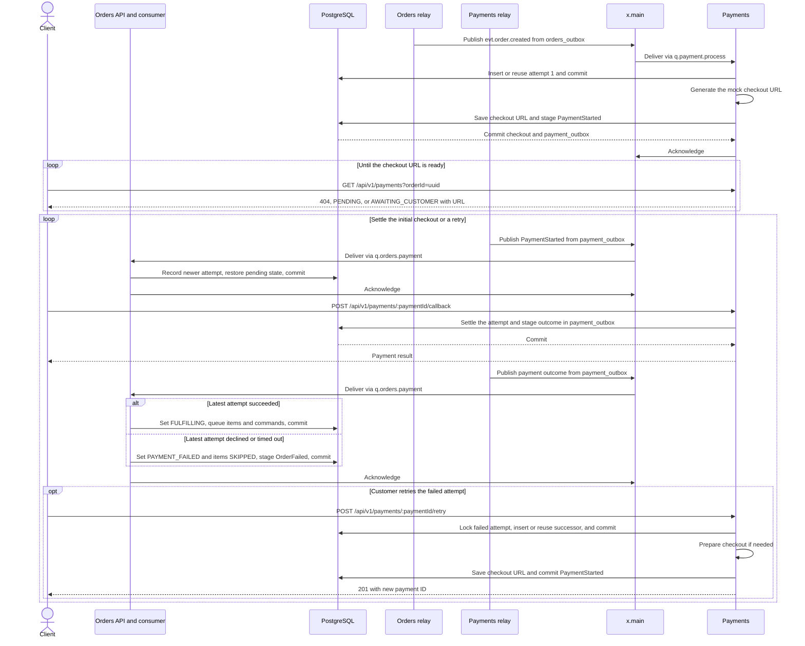
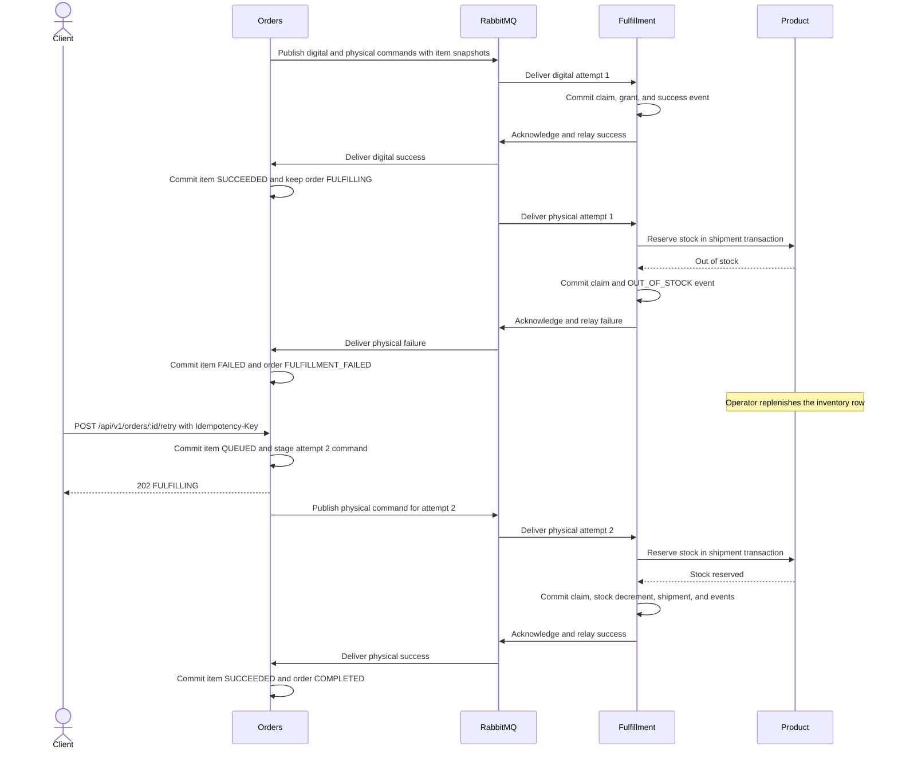

# Payment, fulfillment, and retry

Use cases run transactions through `TransactionManager.run`. For physical items, Fulfillment passes the transaction context to Product's reservation operation. Each module relays messages from its own outbox.

## Checkout and payment

Payments uses its attempt rows to recognize retries and redeliveries. Orders uses the attempt number to handle duplicate or out-of-order payment events, including an outcome that arrives before `PaymentStarted`. [Retry API](../contracts.md#retry-payment) · [Payment transaction rules](../design.md#process-payment)

## Item fulfillment and retry

A paid order grants digital access, then retries an out-of-stock physical item. Publish arrows represent each module's outbox relay after commit.

The retry reuses the payment and leaves the digital grant in place. Fulfillment deduplicates commands by item ID and attempt. Orders applies outcomes only to the matching queued attempt. [Fulfillment transaction](../design.md#claim-and-finish-an-item-safely) · [Order outcome transaction](../design.md#apply-the-fulfillment-outcome-to-the-order)
